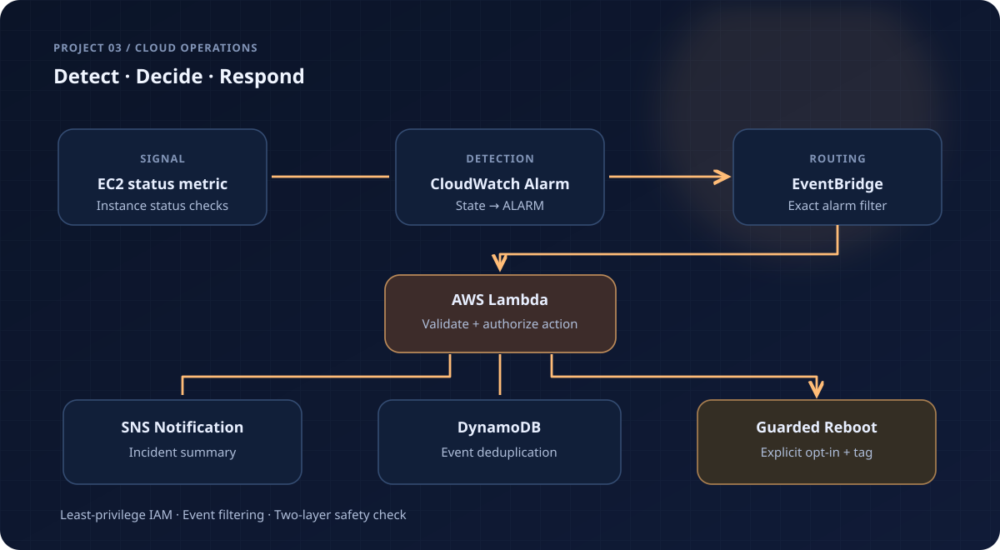

# AWS CloudWatch Monitoring & Safe Auto-Remediation

An event-driven operations workflow centered on an existing EC2 instance. A CloudWatch alarm emits an EventBridge event; a narrowly scoped Lambda function validates the event, deduplicates it, sends an SNS notification, and optionally requests an EC2 reboot.



## Event flow

1. CloudWatch evaluates the EC2 `StatusCheckFailed_Instance` metric for **one configured instance**.
2. EventBridge matches its transition into `ALARM`, filtering by the exact alarm ARN and name.
3. Lambda verifies the event, the instance ID, the current instance state, and an explicit opt-in tag.
4. A conditional DynamoDB write de-duplicates event deliveries for one hour (TTL deletion is asynchronous).
5. SNS receives an incident message. Reboot is only requested when **both** `enable_reboot=true` and the EC2 tag `PortfolioRemediation=allow` are set.

The defaults are **notification-only**; this is intentional so project code cannot unexpectedly reboot an unrelated instance. An email subscription, if configured, requires confirmation.

## Project contents

- `main.tf` — SNS topic, CloudWatch alarm, EventBridge rule, DynamoDB table, Lambda and scoped IAM policy
- `lambda/remediate.py` — validated event handler and decision logic
- `tests/` — offline unit tests for event filtering and two-part reboot authorization
- `.github/workflows/validate.yml` — Python and Terraform source validation

## Local unit tests

```bash
python -m unittest discover -s tests -v
```

## Deploy to an existing instance (optional, billable)

Make sure the chosen AWS account and region contain the instance. This project does **not** create or manage the EC2 instance itself.

```powershell
Copy-Item terraform.tfvars.example terraform.tfvars
# Edit monitored_instance_id to match your own EC2 instance.
$env:AWS_PROFILE = "portfolio"
aws sts get-caller-identity
terraform init
terraform validate
terraform plan
# After reviewing your costs and plan:
terraform apply
# Remove project resources after use:
terraform destroy
```

Rebooting an EC2 instance can interrupt its workload. Only enable the action deliberately and never use a production instance for an experiment. The IAM policy limits `ec2:RebootInstances` to the configured instance ARN; `ec2:DescribeInstances` requires wildcard resource scope. No cloud credentials are committed to source control.

## Extensions

- Route incidents to Slack or a ticketing queue.
- Persist remediation outcomes and include escalation policies.
- Add richer alarm categories and a controlled response per symptom.
- Add IAM boundaries and operational dashboards for a production deployment.
